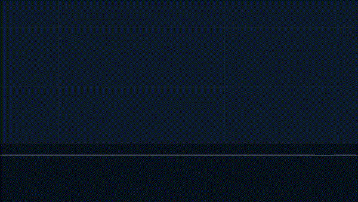

#  Project Event Horizon — Anomaly Diagnostics Lab

##  Mission Briefing

> **FROM:** Dr.Michelle, Senior AI Forensics & Flight Safety Officer  
> **TO:** AI Research Recruits  
> **LOCATION:** Orbital Station *Event Horizon* — Telemetry Control Hub  
> **CLASSIFICATION:** Level 4 Internal Audit  

*Recruit,*

Orbital Station *Event Horizon* relies on an MLP neural field classifier to isolate the reactor's safe plasma core (**inner vortex**) from lethal solar flare bursts (**pulsating radiation ring**).

During our last solar transit, telemetry models built by Dr. Sparsh began exhibiting mysterious anomalies: execution crashes on flight hardware, erratic gradient spikes during solar flare surges, and desynchronization between forward sensor physics and backpropagation update rules.

I have locked down the neural laboratory. You have been assigned to audit the codebase, diagnose 4 telemetry anomalies, repair the underlying mathematical defects, and evaluate the containment field's true reliability.

This challenge is not just about getting high accuracy numbers—it is about **how you investigate system failure when code behaves unexpectedly.**

---

##  The Dataset: Pulsating Plasma Vortex

The classifier must separate an inner reactor core from an outer pulsating radiation ring modulated by non-linear plasma wave ripples:

$$r_0(\theta) = \text{uniform}(0, 0.8) + A \cdot \sin(k \cdot \theta)$$
$$r_1(\theta) = \text{uniform}(1.3, 2.0) + A \cdot \cos(k \cdot \theta)$$

Healthy models should learn a closed, starburst-like non-linear decision boundary across fresh telemetry data.

<p align="center">
  
</p>

---

##  Environment Setup (Using `uv`)

This project is managed with **`uv`**. Follow these steps to initialize your local environment:

```bash
# 1. Install dependencies & set up virtual environment
uv sync

# 2. Run pytest suite to verify helper functions
uv run pytest

# 3. Run full telemetry diagnostic audit
uv run event-horizon
```

### Regenerating the README Animation

The animated project header is generated from
[`animations/event_horizon_intro.py`](animations/event_horizon_intro.py) using
[Manim Community](https://www.manim.community/):

```bash
uv sync --group animation
uv run --group animation manim -r 600,338 --fps 8 --format=gif \
  animations/event_horizon_intro.py EventHorizonIntro
```

Copy the rendered GIF reported by Manim to
`docs/assets/event-horizon.gif`. The custom resolution and frame rate
intentionally keep the README asset lightweight.

---

##  Diagnostic Tasks

Each task represents a station alert. Run the command to inspect the system output and plots (`plt.show()`):

### 1. Diagnostic 01 — Tensor Alignment Fault
* **Run command:** `uv run event-horizon -d 1`
* **Module:** `src/event_horizon/tensor_alignment.py`
* **Station Alert:** *"The training process crashes immediately when launched. Investigate the crash and get the script running cleanly."*

### 2. Diagnostic 02 — Batch Flux Instability
* **Run command:** `uv run event-horizon -d 2`
* **Module:** `src/event_horizon/batch_flux.py`
* **Station Alert:** *"The model behaves completely differently when training on 50 samples versus 5,000 samples. Find out why changing the dataset size destabilizes training."*

### 3. Diagnostic 03 — Phase Shift Desynchronization
* **Run command:** `uv run event-horizon -d 3`
* **Module:** `src/event_horizon/phase_desync.py`
* **Station Alert:** *"The program runs without any error messages, but the model fails to learn and the loss refuses to drop. Diagnose why training is stuck."*

### 4. Diagnostic 04 — Flight Hardware Neural Pruning Audit
* **Run command:** `uv run event-horizon -d 4`
* **Module:** `src/event_horizon/field_stress.py`
* **Station Alert:** *"Flight hardware reports memory overhead from inactive neural channels. Identify and prune all dead neurons from the model while maintaining 100% of its accuracy."*

---

## Submission via GitHub Pull Requests

Recruits must submit their work via GitHub Pull Requests against the main repository:

1. **Fork & Clone:** Fork this repository to your personal GitHub account and clone it locally.
2. **Environment Setup:** Run `uv sync` to set up your environment.
3. **Investigate & Resolve:** Work through the GitHub Issues created for each diagnostic:
   * **Diagnostic 01:** Resolve telemetry execution crash (Addresses Issue #1).
   * **Diagnostic 02:** Resolve dataset scaling instability (Addresses Issue #2).
   * **Diagnostic 03:** Resolve convergence phase desynchronization (Addresses Issue #3).
   * **Diagnostic 04:** Complete neural pruning audit and document findings in `REPORT.md` (Addresses Issue #4).
4. **Submit PR:** Open a Pull Request from your branch back to the main repository referencing the solved issue (e.g., `Fixes #1` or `Resolves telemetry diagnostics`).

Good luck, recruit. Station safety depends on your code analysis.
